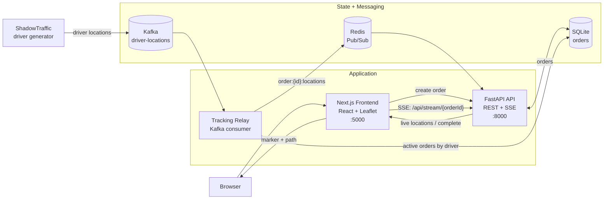

# Delivery Traffic

Real-time delivery tracking demo with generated driver location traffic, a FastAPI backend, Redis Pub/Sub, SQLite order state, and a Next.js map frontend.

## Architecture

## Runtime Components

- `frontend`: Next.js app on port `5000`; creates tracking requests and renders live courier positions with Leaflet.
- `api`: FastAPI app on port `8000`; assigns orders, reads order state, and exposes order-specific SSE streams.
- `tracking-relay`: Kafka consumer that reads driver locations, matches them to active orders, and publishes updates to Redis channels.
- `redis`: Pub/Sub fanout layer between the relay and API stream handlers.
- `shadowtraffic`: synthetic driver location producer for the `driver-locations` Kafka topic.
- `delivery-data`: Docker volume containing the SQLite database at `/data/delivery.db`.

## Event Flow

1. The frontend calls `POST /api/orders` to activate the next predefined order.
2. The API stores order status in SQLite and returns the assigned driver.
3. The frontend opens `GET /api/stream/{order_id}` as a Server-Sent Events connection.
4. ShadowTraffic produces driver location events into Kafka.
5. The tracking relay consumes Kafka events, finds active orders for each driver, and publishes order-specific events to Redis.
6. The API forwards Redis Pub/Sub messages to the browser over SSE.
7. The frontend updates the Leaflet marker as new locations arrive.
